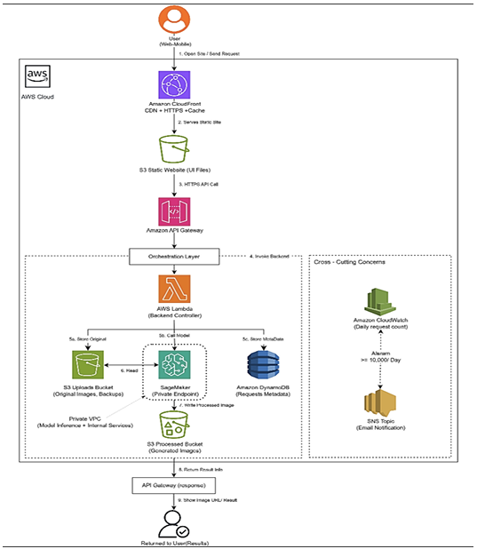
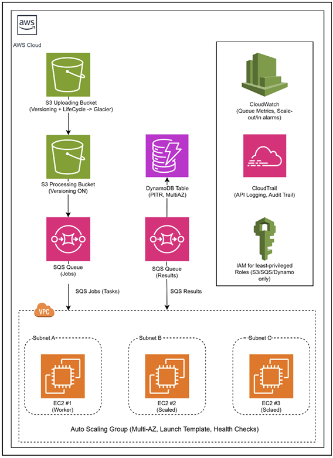

# ☁️ AWS Cloud Architecture & WordFreq Auto Scaling

### Cloud Architecture Design · Distributed Processing · Auto Scaling · Load Testing

**MSc Data Science | University of Bristol | Large Scale Data Engineering (EMATM0051) | 2025**

An AWS coursework case study combining **a proposed serverless architecture for an AI image service (ArtAI)** with **hands-on deployment, scaling and performance testing of a provided word-frequency processing application (WordFreq)**.

> **Project scope:** This is a **documentation and infrastructure case study**, not a source-code release. The WordFreq application was supplied for the coursework; my work covered its AWS deployment and configuration, autoscaling, load testing, evaluation and proposed architecture improvements. ArtAI was an architecture design exercise, not a deployed application.

## 📌 Project at a Glance

| Component | Nature of work | Main AWS services |
| --- | --- | --- |
| **Part 1: ArtAI** | Serverless application **architecture design** | CloudFront, S3, API Gateway, Lambda, SageMaker, DynamoDB, CloudWatch, SNS |
| **Part 2: WordFreq** | **Deployment and load testing** of a coursework-provided application | S3, SQS, EC2, EC2 Auto Scaling, DynamoDB, CloudWatch, IAM |
| **WordFreq improvements** | Proposed resilience, security and cost enhancements | S3 lifecycle/versioning, DynamoDB PITR, IAM, CloudTrail, Spot Instances |

## 🏛️ Part 1 — ArtAI: Serverless Architecture Design

**Scenario:** Design an AWS-hosted service that accepts uploaded images and returns AI-transformed images, with scalable global delivery, protected model inference, storage and alerting when daily request volume exceeds **10,000**.



*Figure: proposed ArtAI architecture. This is a design, not evidence of deployment.*

**Designed request flow:**

1. **S3 + CloudFront** serve the frontend to users.
2. **API Gateway** receives and controls requests.
3. **AWS Lambda** coordinates upload handling, inference requests and metadata updates.
4. A **private SageMaker endpoint** processes the input image.
5. Separate **S3 buckets** hold original and processed images; **DynamoDB** stores metadata.
6. **CloudWatch + SNS** provide monitoring and a notification design for the daily request threshold.

The proposed design also considers least-privilege IAM access, private model inference, encryption and storage lifecycle policies. These are **architecture decisions proposed in the report**, not operationally verified controls.

## ⚙️ Part 2 — WordFreq: Distributed Text Processing

### Objective

Deploy an existing WordFreq application in an AWS Academy environment and test how SQS-driven EC2 workers behave when processing a burst of text files. Each worker calculates the **10 most frequent words** in a text file.

### Implemented processing workflow

```text
Text files uploaded to S3
          ↓
       SQS jobs queue
          ↓
  EC2 WordFreq worker(s)
          ↓
   ┌──────┴─────────┐
   ↓                ↓
DynamoDB       SQS results queue
(top-10 words)  (processed results)
```

**Implementation and configuration covered:**

- Deployed the provided WordFreq application on an Ubuntu-based **EC2** instance and validated a test file through the processing pipeline.
- Configured **S3 input/processing buckets**, **SQS jobs/results queues** and **DynamoDB** output storage.
- Created a worker **AMI** and EC2 launch template for an **Auto Scaling Group**.
- Configured **CloudWatch alarms** to react to queue backlog and scale the workers out or in.
- Tested a working capacity of **minimum 1, desired 1, maximum 5** workers.

### Auto-scaling configuration

| Setting | Baseline configuration | Optimised test configuration |
| --- | --- | --- |
| EC2 instance type | `t3.micro` | `t3.small` |
| Scale-out queue threshold | More than 20 messages | More than 20 messages |
| Scale-out evaluation | 2 of 2 datapoints over 2 minutes | 1 datapoint over 10 seconds |
| Scale-in queue threshold | 5 or fewer messages | 5 or fewer messages |
| Instance warm-up | 120 seconds | 120 seconds |
| Scale-in cooldown | 180 seconds | 180 seconds |
| Auto Scaling Group capacity | Min 1 / Desired 1 / Max 5 | Min 1 / Desired 1 / Max 5 |

*The table summarises configuration values recorded in the coursework report.*

## 📈 Load Testing & Observations

The report describes a burst test using **120 text files**, with queue, EC2 worker and CloudWatch observations recorded during processing.

| Reported observation | Result |
| --- | --- |
| Input workload | 120 `.txt` files |
| SQS jobs backlog | Approximately 95 visible messages at a peak observation |
| Completed output | 120 results messages observed; jobs backlog returned to zero |
| Baseline processing time | Approximately **8–9 minutes** |
| Optimised processing time | Approximately **4–5 minutes** |
| Approximate processing-time reduction | **Around 50%**, as reported in the coursework |

The report's test screenshots show the SQS backlog decreasing as EC2 capacity increased, followed by a return toward the minimum worker capacity as the queue cleared.

**Interpretation:** The optimised run finished more quickly in the documented coursework test. However, **both CloudWatch scaling settings and the EC2 instance type changed**, so the experiment does **not** isolate the effect of the scaling policy alone. The result is not a production benchmark or a guarantee of performance under other workloads.

## 🛡️ Proposed WordFreq Architecture Improvements



*Figure: improved architecture proposal from the report. Not all depicted enhancements were deployed during testing.*

Further design recommendations in the coursework included:

- Multi-subnet worker placement for resilience.
- S3 versioning and lifecycle transitions for data protection and storage cost management.
- DynamoDB Point-in-Time Recovery and on-demand capacity.
- More restrictive IAM permissions, limited SSH access and CloudTrail auditing.
- Potential EC2 Spot Instances for appropriate workloads.
- **AWS Lambda** or **AWS Batch** as alternatives to managing EC2 workers directly.

These were **proposals/evaluations**, not additional tested implementations.

## 🧰 Technologies

`Amazon S3` · `Amazon SQS` · `Amazon EC2` · `EC2 Auto Scaling` · `Amazon DynamoDB` · `Amazon CloudWatch` · `AWS IAM` · `AWS CLI`

**Architecture-only / proposed services:** `CloudFront` · `API Gateway` · `Lambda` · `SageMaker` · `SNS` · `CloudTrail` · `AWS Batch`

## 📁 Repository Structure

```text
AWS-Cloud-Architecture-and-WordFreq-Scaling/
├── README.md
├── Report/
│   └── AWS_Coursework_Public.pdf
└── Diagrams/
    ├── Artai_Architecture.png
    └── Wordfreq_Architecture.png
```

> The image and PDF links assume the filenames shown above. If the uploaded files have different names, update the corresponding paths in this README.

## 📄 Report & Evidence

The [coursework report](Report/AWS_Coursework_Public.pdf) includes architecture diagrams, AWS configuration screenshots, SQS/EC2/CloudWatch monitoring evidence, and a baseline-versus-optimised settings table.

**Reproducibility note:** The repository does not include the coursework-provided WordFreq source code, infrastructure-as-code templates, or the original live AWS Academy environment. It documents the reported implementation and observations rather than providing a one-command deployment.

## ⚠️ Limitations

- ArtAI was **designed**, not deployed or benchmarked.
- WordFreq source code was provided through coursework and is **not redistributed** here.
- Tests used a limited workload of 120 text files in a temporary educational AWS environment.
- Baseline and optimised runs used different EC2 instance types as well as different scaling settings.
- Proposed security, backup and architecture improvements were **not all implemented or validated**.

## 📚 References

- [Amazon EC2 Auto Scaling Documentation](https://docs.aws.amazon.com/autoscaling/ec2/userguide/)
- [Amazon SQS Developer Guide](https://docs.aws.amazon.com/AWSSimpleQueueService/latest/SQSDeveloperGuide/)
- [Amazon S3 User Guide](https://docs.aws.amazon.com/AmazonS3/latest/userguide/)
- [Amazon DynamoDB Developer Guide](https://docs.aws.amazon.com/amazondynamodb/latest/developerguide/)
- [Amazon CloudWatch User Guide](https://docs.aws.amazon.com/AmazonCloudWatch/latest/monitoring/)

---

*Academic portfolio case study based on work completed for the University of Bristol's Large Scale Data Engineering coursework (2025).*
